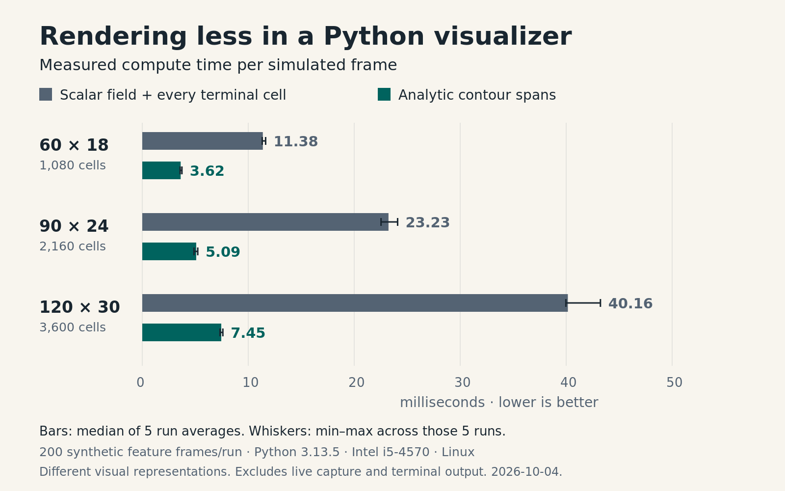

# Rendering less in a Python visualizer

**Tucker Vana · Engineering case study · October 4, 2026**

At a 120 × 30 terminal viewport, two rendering strategies in my audio visualizer took **40.16 ms and 7.45 ms per simulated frame** on the same machine. That is a **5.39× ratio in measured compute time**.

The useful question is what produced the difference, what the comparison can establish, and whether the cheaper path still meets the program's requirements.

## The problem

I maintain [Lavatune](https://github.com/tuckeefro/lavatune), a Python application that turns local audio into moving shapes. It began as a small visualizer for my Linux workspace. A persistent desktop tool needs to leave room for the work happening around it.

The rendering decision is straightforward to describe. Should the program construct a field of intensity values and sample every terminal cell, or should it calculate the shapes' outlines and emit occupied spans directly?

Both strategies already existed in the repository. This study measures them at one pinned revision. It does not reconstruct a historical before-and-after release comparison.

## Two representations, different work

The **scalar-field path** constructs a grid describing body mass and visual activity. It then calculates a glyph for every cell in the output viewport, including cells that become blank. Its simulation grid is already narrower than the terminal: one third of the output width, with a minimum of ten columns.

The **contour path** works from the bodies' geometry. It intersects shapes with terminal rows, calculates glyphs within candidate bounds, and returns occupied spans. It skips the scalar-field rasterization stage. A separate terminal layer compares the old and new spans, writes changed runs, and clears cells where a shape has moved away.

The paths produce different images and use different simulation dimensions and surface behavior. **The result compares complete rendering strategies; it cannot attribute the entire difference to a single optimization.** [Rendering code](https://github.com/tuckeefro/lavatune/blob/f79516e82b9b6383ea1d169be2937c9ba6a5a93d/src/lavatune/fluid.py#L97)

## How the measurement was made

The public source was fixed at commit `f79516e82b9b6383ea1d169be2937c9ba6a5a93d`. All 72 fetched files were checked against their Git blob IDs and SHA-256 hashes before execution.

The experiment used three viewport sizes, two paths, and five repeated runs per combination: **30 observations**. Each run processed 200 synthetic feature frames, covering two complete repetitions of the repository's silence, speech-like, music-like, and transient sequence. Four bodies were configured. Path order alternated between repetitions.

The machine ran Python 3.13.5 on Linux with an Intel i5-4570. Timing covered feature mapping, simulation, and material computation. Live audio capture, terminal writes, the terminal emulator, and the compositor were outside the measurement. No power consumption was measured.

Each observation is the average time per frame within a run. The table reports the median of five such observations. These are not individual-frame latency percentiles. [Harness](https://github.com/tuckeefro/lavatune/blob/f79516e82b9b6383ea1d169be2937c9ba6a5a93d/scripts/benchmark_render.py#L25)

## Results

| Viewport | Scalar field, ms/frame | Contours, ms/frame | Scalar / contour |
|---|---:|---:|---:|
| 60 × 18 | 11.38 | 3.62 | 3.14× |
| 90 × 24 | 23.23 | 5.09 | 4.57× |
| 120 × 30 | 40.16 | 7.45 | 5.39× |

From the smallest viewport to the largest, output cell count grew 3.33×. Scalar-path time grew about 3.53×; contour-path time grew about 2.06×. Three sizes establish an observed trend on this workload, not a general scaling law.

## What the program avoids doing

A separate diagnostic replay counted the work around the rendered output. At 120 × 30, the scalar path evaluated **720,000 terminal cells across 200 frames**; **81.9% produced blank glyphs**. The contour path emitted about **642 occupied cells per frame**. It still does internal geometry and shading work, so emitted-cell count is not its total operation count.

The contour cache recorded **zero hits in that 200-frame replay** at the largest viewport. The cheaper path remained useful while rebuilding its output. Repeatedly returning an unchanged cached frame does not explain that diagnostic result.

Source inspection and the replay give a concrete explanation consistent with the timings: the contour strategy removes a rasterization stage and limits material work to candidate regions. Isolating how much each change contributes would require a controlled ablation.

## Reliability needs its own evidence

The capture thread retains at most eight sequenced feature frames and wakes the main loop through a nonblocking pipe. Overflow discards the oldest retained frames. That bounds the queue and makes missing sequence numbers observable; it does not guarantee that every captured event survives a stalled consumer. [Queue contract](https://github.com/tuckeefro/lavatune/blob/f79516e82b9b6383ea1d169be2937c9ba6a5a93d/tests/test_audio.py#L75)

The terminal/core subset passed **222 tests**, including Linux pseudo-terminal resize and exit checks. The full suite ran 236 tests and reported ten errors because Tkinter was unavailable. All 14 window tests were excluded from the separate subset, and the full failure log was retained. This run provides no GUI validation or live audio-to-display latency measurement.

The measurement packet also has eleven passing checks for complete observations, duplicate keys, timing validity, CSV/SQLite agreement, and summary calculations. A fast number is only useful if its inputs and aggregation can be inspected.

## The engineering decision

These measurements support keeping the contour strategy for Lavatune's terminal presentation. It has substantially lower measured compute cost across the three tested sizes, and existing tests cover specific rendering and runtime contracts.

The strongest objection is visual equivalence: changing representation can change what the user sees. The acceptance question remains whether those changes serve this visualizer. Automated contour checks cannot settle that aesthetic judgment.

The next performance claim needs a different experiment: timestamp a controlled feature event through the live terminal loop, record event-to-draw latency and dropped sequence numbers, and test quiet and burst cadence. If capture, scheduling, or terminal output dominates that result, further material optimization would be a poor next investment.

## Evidence and authorship

The accompanying [methods](methods.md), raw observations, scripts, and logs specify how to inspect and reproduce the comparison. Exact timings will vary by machine.

Lavatune was developed with OpenAI Codex under my direction. Codex also assisted with this analysis and document. The project's [authorship record](https://github.com/tuckeefro/lavatune/blob/f79516e82b9b6383ea1d169be2937c9ba6a5a93d/AUTHORS.md) describes that process.

Additional source anchors: [synthetic inputs](https://github.com/tuckeefro/lavatune/blob/f79516e82b9b6383ea1d169be2937c9ba6a5a93d/scripts/benchmark.py#L26), [optional rasterization](https://github.com/tuckeefro/lavatune/blob/f79516e82b9b6383ea1d169be2937c9ba6a5a93d/src/lavatune/runtime.py#L285), [sparse terminal changes](https://github.com/tuckeefro/lavatune/blob/f79516e82b9b6383ea1d169be2937c9ba6a5a93d/src/lavatune/tui.py#L335).
